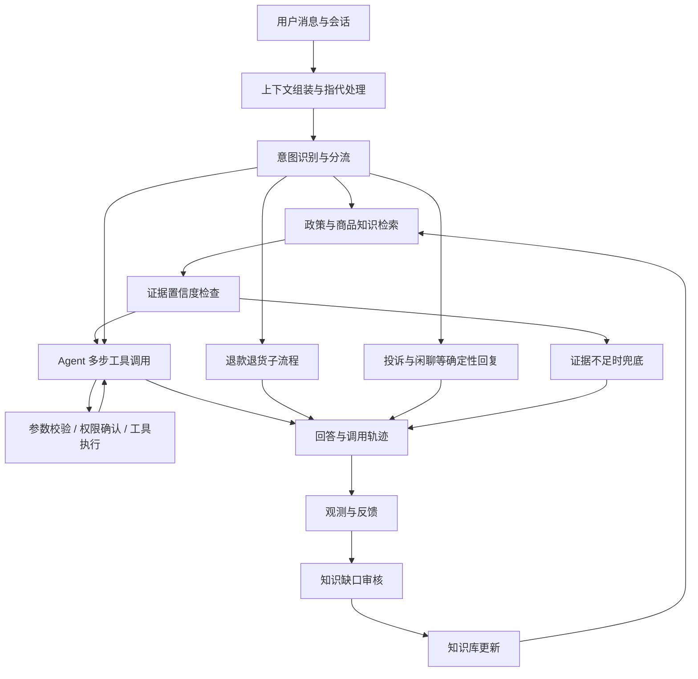

<div align="center">

# CommerceFlow

**面向电商售后的 Workflow + Agent 智能客服平台。**

连接政策知识、业务查询、退款流程与质量评估，让问答和业务操作在可检查的执行链路中完成。

[核心能力](#核心能力) · [项目结构](#项目结构) · [快速开始](#快速开始) · [业务流程](#业务流程) · [配置说明](#配置说明) · [评估与测试](#评估与测试)

Python 3.12+ · FastAPI · LangGraph · Milvus · MCP · Langfuse

</div>

---

CommerceFlow 将确定性的业务校验与 Agent 的多步工具调用结合，覆盖政策问答、订单物流查询、退款退货、工单确认和多轮上下文管理。系统同时提供知识库录入、反馈审核、调用观测、检索评估和主题分类页面。


## 核心能力

| 能力 | 实现与用途 |
| --- | --- |
| **业务流程编排** | 基于 LangGraph 将九类意图映射到五个业务出口，串联必要检索、业务校验、Agent 调用与确定性回复。 |
| **检索增强问答** | 支持向量、BM25、混合召回与重排，对比不同检索策略，并通过证据置信度与生成自检控制回答质量。 |
| **业务工具执行** | 统一内置工具与 MCP 工具，进行参数校验、身份注入、订单归属校验、写操作确认与执行审计。 |
| **多轮上下文** | 使用历史窗口、分段摘要、指代处理和工具结果压缩组织后续请求。 |
| **反馈与知识回流** | 将低置信度、生成自检和用户反馈信号送入审核流程，审核后补充知识库。 |
| **可观测与评估** | 接入 Langfuse 追踪调用，提供意图成本、检索质量、阈值校准和评估趋势视图。 |
| **主题分类** | 提供 17 类主题的语料处理、训练、评测与 ONNX 推理流程，支持问题归类和分类器验收。 |

### 示例问题

```text
订单 1001 的物流到哪里了？
收到商品后，什么情况下可以申请退货？
我想退掉刚才那笔订单，需要提供哪些信息？
帮我创建一个售后工单。
```


## 项目结构

```text
app/
├── main.py           # FastAPI 入口与生命周期
├── api/              # 对话、知识库、审核、评估和后台接口
├── graph/            # LangGraph 节点、路由与运行时
├── core/             # 模型调用、检索、摘要、置信度与观测
├── tools/            # 工具注册、执行引擎与内置业务工具
├── kb/               # 文档切分、入库、去重与知识回流
├── db/               # 数据模型与仓储
├── schemas/          # API 数据结构
└── static/           # 对话界面与管理页面
mcp_servers/          # 物流、售后 MCP 服务
scripts/              # 建库、评估、训练、推理及开发脚本
sql/                  # 按顺序执行的数据库初始化与迁移文件
tests/                # 单元、API、图编排和数据库测试
data/                 # 知识材料、评测数据与报告
primer/               # 模型调用与 Agent 的独立示例
docs/superpowers/     # 设计取舍与实施记录
```

## 快速开始

### 环境要求

- Python **3.12+** 和 uv。
- Docker 与 Docker Compose，用于 MySQL、Milvus、etcd、MinIO。
- Bash、Make 和 curl；现有脚本使用 POSIX 命令，Windows 建议在 WSL 中执行部署流程。
- 可用的聊天、嵌入和重排服务配置。


### 1. 安装依赖并填写配置

```bash
uv sync --locked
cp .env.example .env
```

编辑 `.env`，填写真实可用的服务配置：

```dotenv
CHAT_BASE_URL=https://your-chat-provider.example/v1
CHAT_MODEL=your-tool-capable-model
CHAT_API_KEY=your-chat-api-key
EMBED_API_KEY=your-embedding-api-key
RERANK_API_KEY=your-rerank-api-key
```


### 2. 启动基础服务并构建知识库

```bash
docker compose up -d
# 等待容器健康检查通过后继续
make seed
make seed-conv
make kb-build
make kb-vectorize
```

- MySQL 保存会话、知识原文、审核记录和工具审计。
- Milvus 保存检索索引，依赖 etcd 与 MinIO。
- `kb-build` 将知识材料切分并写入数据库；`kb-vectorize` 调用嵌入服务构建向量索引。


### 3. 启动应用

```bash
make dev
```

该入口启动或检查基础容器、等待 Milvus、拉起两个业务 MCP 服务，并启动 FastAPI 应用。

打开 `http://localhost:8000`，输入“订单 1001 的物流到哪里了”，检查回答及订单、物流工具调用轨迹。

```bash
# 停止应用与 MCP 后台进程
make dev-down
```


### 页面与端口

| 入口 | 用途 |
| --- | --- |
| `http://localhost:8000/` | 客服对话 |
| `/admin` | 后台入口 |
| `/kb` | 知识录入与检索自测 |
| `/review` | 知识回流审核 |
| `/rag-eval` | 检索评估 |
| `/observability` | 观测与成本 |
| `/topics` | 主题分布 |
| `/acceptance` | 分类器验收 |
| `/docs` | FastAPI 接口文档 |

应用使用 `8000`，物流与售后 MCP 服务使用 `8101` / `8102`；MySQL 使用 `3306`，Milvus 使用 `19530`，健康检查使用 `9091`。可选的 Langfuse 使用 `3000`，分类器推理服务使用 `8110`。

## 业务流程



业务操作的必要检查由 Workflow 和工具层承担。Agent 在允许的范围内选择工具并组织回复；写操作需要确认，执行记录进入审计。知识问答先检索和检查证据，避免直接将低置信度内容交给模型生成答案。

### 工具与业务数据

- 内置工具与两个 MCP Server 通过统一注册表和执行引擎接入。
- 订单身份由系统侧注入，订单归属校验由共享业务函数处理。
- 订单和物流采用演示数据，不存在对真实电商平台的默认连接。
- 数据库和知识库承担会话、检索、审核与审计持久化，不能将演示业务数据与真实交易数据混为一谈。

## 配置说明

运行配置由根目录 `.env` 和环境变量提供，模板见 [.env.example](.env.example)。

| 配置组 | 用途 |
| --- | --- |
| `CHAT_*` | 聊天模型、地址、密钥及可选思考参数 |
| `EMBED_*` | 嵌入模型与服务 |
| `RERANK_*` | 重排模型与服务 |
| `INTENT_*`、`SUMMARY_*` | 意图与摘要模型；未单独配置时按代码中的回退规则使用聊天配置 |
| `DATABASE_URL` | 应用数据库，默认库名 `commerceflow` |
| `TEST_DATABASE_URL` | 专用测试数据库，默认库名 `commerceflow_test` |
| `MCP_LOGISTICS_URL`、`MCP_AFTERSALES_URL` | 物流与售后工具服务 |
| `LANGFUSE_PUBLIC_KEY`、`LANGFUSE_SECRET_KEY`、`LANGFUSE_BASE_URL` | 可选的调用追踪配置 |

> 数据库测试会删除并重建测试表。`TEST_DATABASE_URL` 必须指向独立测试库，不可复用业务库。

### 可选：可观测服务

```bash
make langfuse-up
# 在 .env 中填写对应的 Langfuse 配置后重新启动应用
make cost-report
```

调用追踪和成本页面需要实际调用记录。Compose 中的默认凭据用于本地演示，外部部署应配置独立凭据与访问控制。

### 可选：主题分类器

```bash
uv sync --locked --group ml
make classifier-corpus
make classifier-dataset
make classifier-train
make classifier-eval
make classifier-export
make classifier-up
```

这条流程涉及模型服务、数据处理与训练资源，不是基础客服问答的启动前置条件。训练与评测产物由脚本生成；指标应以对应数据划分和实际评测报告为准。

### 项目命名与已有数据

运行配置统一使用 `commerceflow`：包括项目元数据、默认数据库、容器、数据卷逻辑名称、Langfuse 初始化信息及浏览器会话键。

**改名不会自动迁移旧数据。** 已有部署升级前，应备份旧库与数据卷，核对 Docker Compose 项目名、端口占用及数据库连接配置，选择导出导入或显式挂载既有数据。浏览器的新会话键也不会自动读取旧键。不要通过删除数据卷解决迁移问题。

`app` 是现有 Python 应用包，仍作为 `uvicorn app.main:app` 的入口。SQL、数据目录和部分命令中的 `chNN` 是既有技术标识，保留以维持迁移顺序和脚本引用；功能说明按模块名称组织。

## 评估与测试

```bash
# 查看可用任务
make help

# 单元与集成测试；部分测试需要专用 MySQL 测试库
make test

# 基础 Agent 行为评估
make eval-agent

# 对比检索策略
make eval-retrieval
make eval-rag

# 知识回流与证据阈值评估
make eval-flywheel
make calibrate-confidence
```

测试覆盖路由、工具参数、订单归属、写操作确认、上下文、知识检索、审核回流、分类器及 API 行为。数据库测试依赖 MySQL；端到端评估还需要运行中的应用、Milvus、MCP 和上游模型。
